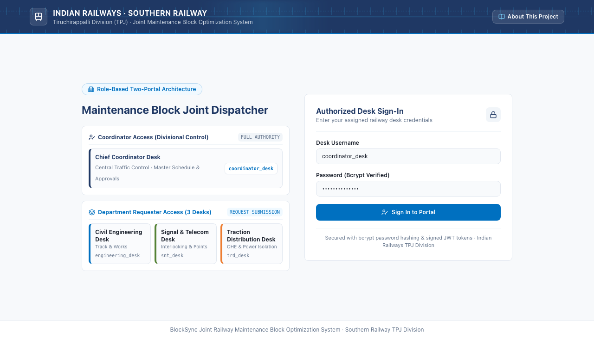

# blocksync

Constraint-optimization engine (OR-Tools CP-SAT) that jointly schedules railway maintenance blocks across Engineering, S&T and TRD, with explainable plans and human approval.

[](https://www.python.org/)
[](https://fastapi.tiangolo.com/)
[](https://react.dev/)
[](https://developers.google.com/optimization)
[](LICENSE)
[](https://github.com/srivarsan007/blocksync/actions/workflows/ci.yml)

---



---

## ✨ Features

- **Deterministic Joint Scheduling**: Solves multi-department track possession allocations using Google OR-Tools CP-SAT constraint programming.
- **Cross-Department Bundling**: Automatically identifies spatial and operational synergies between Civil Engineering, Signal & Telecom (S&T), and Traction Distribution (TRD) to bundle compatible tasks into shared possession closures.
- **Strict Electrical Safety**: Enforces hard non-overlapping constraints during 25kV AC traction overhead equipment (OHE) power de-energization windows.
- **ML Urgency Scoring**: Prioritizes track maintenance backlogs based on safety criticality, overdue delays, and corridor risk factors using an interpretable Random Forest regressor.
- **Explainable Decisions**: Translates complex solver assignments into human-readable explanations detailing why tasks were bundled or separated.
- **Human-in-the-Loop Controller Desk**: Empowers railway traffic controllers to review, approve, modify, or reject solver proposals and issue print-ready sanction sheets.

---

## ⚡ Quick Start

Follow these copy-paste commands to run the backend solver and interactive dashboard locally:

### Prerequisites
- Python 3.10+
- Node.js 18+ and npm

### 1. Install & Run Backend
```bash
git clone https://github.com/srivarsan007/blocksync.git
cd blocksync

# Set up Python virtual environment
python3 -m venv venv
source venv/bin/activate

# Install runtime and testing dependencies
pip install -r requirements-dev.txt

# Run test suite (21 automated unit, integration, and security tests)
PYTHONPATH=. venv/bin/pytest tests/ -v

# Start FastAPI backend server (http://127.0.0.1:8000)
python3 -m uvicorn backend.main:app --port 8000 --host 127.0.0.1
```

### 2. Run Frontend Dashboard
```bash
# In a new terminal window:
cd blocksync/frontend
npm ci
npm run dev

# Open http://localhost:5173 in your browser
```

---

## 🔐 Demo Credentials (Local Evaluation Only)

BlockSync includes seeded accounts for local evaluation across coordinator and department roles.

> [!CAUTION]
> **Security Warning**: Demo mode defaults to **off** (`BLOCKSYNC_DEMO_MODE=false`). **Never enable demo mode in a public or production deployment.** Only enable demo mode locally for offline evaluation. When demo mode is disabled, BlockSync strictly refuses to start unless `PYJWT_SECRET` is explicitly configured.

To enable seeded evaluation accounts for local testing, set `BLOCKSYNC_DEMO_MODE=true` and provide a `PYJWT_SECRET` in your local environment or `.env` file:
```bash
export BLOCKSYNC_DEMO_MODE=true
export PYJWT_SECRET=local-dev-evaluation-secret
```

| Role | Username | Password | Access Level |
|---|---|---|---|
| **Chief Controller** | `coordinator_desk` | `coordinator123` | Master Timeline, Approvals & Sanction Sheets |
| **Civil Engineering** | `engineering_desk` | `engineer123` | Track & Works Request Submission Desk |
| **Signal & Telecom** | `snt_desk` | `snt123` | Interlocking & Points Request Submission Desk |
| **Traction Distribution** | `trd_desk` | `trd123` | 25kV OHE Power Isolation Submission Desk |

When `BLOCKSYNC_DEMO_MODE=true`, `GET /auth/accounts` returns convenient login hints in the local dashboard. When demo mode is off (`false`), no seeded accounts are created and `/auth/accounts` returns an empty array.

---

## 📦 Sample Input & Expected Output

The repository provides a self-contained test scenario in `samples/`:
- `samples/demo_tasks.csv`: The baseline 9-task cross-department backlog.
- `samples/new_request.json`: A sample maintenance request for `POST /tasks`.
- `samples/expected_solver_output.txt`: The actual deterministic solver output.

### Run Sample via Python
```bash
python3 -c "
import pandas as pd
from optimizer.solver import BlockOptimizerSolver

tasks = pd.read_csv('samples/demo_tasks.csv')
windows = pd.read_csv('data/maintenance_windows.csv')
solver = BlockOptimizerSolver(tasks, windows)
schedule, status, _, trace = solver.solve()
print(f'Status: {status} | Scheduled: {len(schedule)}/{len(tasks)} tasks')
for e in schedule:
    print(f'  Task {e.task_id} -> {e.assigned_window_id} ({e.start_minute}m-{e.end_minute}m) [Bundle: {e.bundle_group_id}]')
"
```

Expected output:
```text
Status: OPTIMAL | Scheduled: 9/9 tasks
  Task E1 -> W-A-morning (360m-405m) [Bundle: BUNDLE-A-360]
  Task S1 -> W-A-morning (360m-390m) [Bundle: BUNDLE-A-360]
  Task T1 -> W-A-morning (420m-460m) [Bundle: None]
  Task E2 -> W-A-morning (360m-420m) [Bundle: BUNDLE-A-360]
  Task S2 -> W-B-morning (480m-505m) [Bundle: BUNDLE-B-480]
  Task E3 -> W-B-morning (480m-530m) [Bundle: BUNDLE-B-480]
  Task T2 -> W-B-morning (530m-565m) [Bundle: None]
  Task E4 -> W-C-morning (600m-640m) [Bundle: BUNDLE-C-600]
  Task S3 -> W-C-morning (600m-620m) [Bundle: BUNDLE-C-600]
```

---

## ⚙️ How It Works (In 5 Lines)

1. **Ingest & Rank**: Department work orders are scored for operational urgency using a Random Forest regressor based on safety criticality and overdue delays.
2. **Detect Synergy & Conflicts**: A bipartite conflict graph detects spatial co-location synergies while isolating hazardous TRD 25kV traction power cuts.
3. **Solve Satisfiability**: Google OR-Tools CP-SAT solves an exact mixed-integer constraint model, enforcing track window bounds, zero overlap on electrical cuts, and maximal bundling.
4. **Explain Rationales**: Deterministic explanation logic articulates the reason behind every bundled slot and downtime reduction.
5. **Human Approval**: The Chief Train Controller reviews recommendations, adjusts parameters if needed, and issues a digitally sanctioned block order.

---

## 🛠️ Configuration (`.env.example`)

BlockSync can be customized using environment variables:

| Variable | Description | Default |
|---|---|---|
| `PYJWT_SECRET` | Secret key used to sign and verify session JWTs. **Required when demo mode is off.** | None (startup is refused if unset and demo mode is off) |
| `BLOCKSYNC_DEMO_MODE` | Enables seeded accounts and `GET /auth/accounts` password hints. | `false` |
| `VITE_API_BASE_URL` | Base API URL read by the React dashboard. | `http://127.0.0.1:8000` |

---

## ⚠️ Scope Boundaries, Honesty & Known Limitations

In the interest of full technical integrity and transparency:
1. **Synthetic Maintenance Backlog**: All maintenance requests in `data/sample_dataset.csv` and `samples/demo_tasks.csv` are synthetic work orders formulated according to standard IRPWM and SEM manual frequencies.
2. **Static Timetable Shadowing**: Maintenance windows are derived from published passenger train gaps in `data.gov.in` timetable data; they represent scheduled intervals, not live GPS train status feeds.
3. **ML Priority Scope**: The Random Forest regressor is trained on synthetic urgency labels generated from a documented engineering formula; its $R^2 \approx 0.99$ reflects exact model fidelity to that heuristic formula rather than real-world predictive accuracy.
4. **Baseline vs. Optimized Scenario**: Before/after improvement metrics (e.g. 44% block reduction) reflect performance against one synthetic 9-task scenario.
5. **Planning Horizon**: A rolling 7-day shift planning horizon is supported; monthly long-range capital renewal planning is out of scope.
6. **Demo-Grade Authentication**: The built-in authentication system uses seeded demo accounts for evaluation and is not designed as production identity infrastructure.
7. **No Real System Integration**: BlockSync is an independent prototype and does not connect to Indian Railways live enterprise systems (COA, FOIS, or ICMS).

---

## 📄 License

This project is open-source software licensed under the [MIT License](LICENSE).
Copyright © 2026 Srivarsan K V.

---

## 🙏 Acknowledgements

- **Timetable Dataset**: Ministry of Railways via [data.gov.in](https://data.gov.in/resource/indian-railways-train-time-table) (Open Government Data Platform India), licensed under the [Government Open Data License - India (GODL-India)](https://data.gov.in/government-open-data-license-india).
- **Core Open-Source Libraries**: Google OR-Tools CP-SAT, FastAPI, Scikit-Learn, NetworkX, React, Vite, and Tailwind CSS.
- **AI Coding Assistance**: AI coding tools were used in developing and refining portions of this project.
